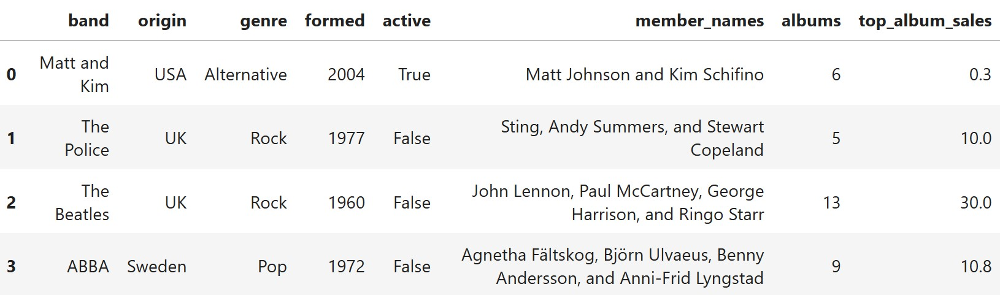

A band is a group of musicians who regularly perform and record music together. Some of the most successful bands in history have sold hundreds of millions of records and sold out stadiums worldwide, becoming a central part of popular culture.

In this exam, we'll study a dataset of **400 bands**, which we will treat as a **simple random sample** from the population of all bands. The DataFrame `bands` has one row for every band in our dataset. The columns are:

- `"band"` (`str`): The name of the band. This column has no repeated values.
- `"origin"` (`str`): The country where the band was formed.
- `"genre"` (`str`): The primary musical genre, such as `"Rock"`, `"Pop"`, `"Metal"`, or `"Alternative"`.
- `"formed"` (`int`): The year the band was formed.
- `"active"` (`bool`): `True` if currently active, `False` if disbanded.
- `"member_names"` (`str`): The names of the members in the most recent lineup.
- `"albums"` (`int`): Total number of studio albums released.
- `"top_album_sales"` (`float`): Worldwide sales of the band's best-selling album, in millions of copies.

The first few rows of `bands` are shown below, but remember that `bands` has 400 rows.

Throughout this exam, we will refer to `bands` repeatedly. Assume that we have already run `import babypandas as bpd`, `import numpy as np`, and `import scipy`.