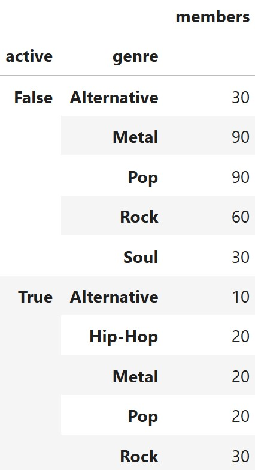

# BEGIN PROB

\[(8 pts)\]

Below is one line of code and the DataFrame it produces.

```py
bands.get(["active", "genre", "members"]).groupby(["active", "genre"]).count()
```

<center></center>

# BEGIN SUBPROB

Using this DataFrame, calculate the total variation distance (TVD) between the `"genre"` distribution of active bands and the `"genre"` distribution of inactive bands. Give your answer as an **exact decimal or simplified fraction**.

::: center
:::

# BEGIN SOLUTION

**Answer:**

0.3

**Solution:**

To calculate TVD, we first convert the genre counts into proportions separately for active and inactive bands. We then find the absolute difference between the two proportions for each genre, add these differences, and divide the sum by 2. Using the values in the DataFrame gives a TVD of $\boxed{0.3}$, indicating that the two genre distributions differ by a total variation distance of 0.3.

# END SOLUTION

# END SUBPROB

# BEGIN SUBPROB

Suppose you randomly draw one band uniformly from `bands`. You are told that this band is **not** a rock band. What is the conditional probability that the band is active? Give your answer as an **exact decimal or simplified fraction**.

::: center
:::

# BEGIN SOLUTION

**Answer:**

$\frac{7}{31}$

**Solution:**

Since we know the selected band is not a rock band, we restrict our attention to the **310 non-rock bands**. Of these, **70 are active**, so the conditional probability is the number of active non-rock bands divided by the total number of non-rock bands. Therefore, $P(\text{Active} \mid \text{Not Rock}) = \frac{70}{310} = \boxed{\frac{7}{31}}$.

# END SOLUTION

# END SUBPROB

# END PROB