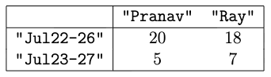
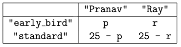

# BEGIN PROB

# BEGIN SUBPROB

The number of reservations for each of the `"dates"` processed by each coordinator are given in the table to the right.

Compute the total variation distance (TVD) between Pranav's distribution of `"dates"` and Ray's distribution of `"dates"`. Give your answer as an **exact decimal or simplified fraction**.

# BEGIN SOLUTION

**Answer**: $0.08$
Total Variation Distance (TVD) measures how different two distributions are. First, calculate the proportion of reservations in each date category for both coordinators.
| Date | Pranav | Ray | Absolute Difference |
|---|---:|---:|---:|
| Jul 22-26 | 20/25 = 0.80 | 18/25 = 0.72 | 0.08 |
| Jul 23-27 | 5/25 = 0.20 | 7/25 = 0.28 | 0.08 |
The TVD is half the sum of the absolute differences:
$$
TVD = \frac{1}{2} \times (0.08 + 0.08) = 0.08
$$
<average>37</average>

# END SOLUTION

# END SUBPROB 

# BEGIN SUBPROB

The table to the right shows how many reservations of each `"package"` type were processed by each coordinator.

Which of the following expressions correctly computes the TVD between Pranav's distribution of `"package"` type and Ray's distribution of `"package"` type?

( ) `(p - r) / 25`
( ) `abs(p - r) / 25`
( ) `0.5 * abs(p - r) / 25`
( ) `0.5 * sum(abs(p / 25 - r / 25))`
( ) `0.5 * (abs(p - r) + abs((25 - p) - (25 - r)))`

# BEGIN SOLUTION

**Answer**: Option B

For the early_bird category, the absolute difference between the two distributions is |p-r|/25.

For the standard category, it is:

$$
\left|\frac{25-p}{25}-\frac{25-r}{25}\right|
= \frac{|r-p|}{25}
= \frac{|p-r|}{25}
$$

These two absolute differences are equal because each coordinator has 25 reservations in total. An increase in the number of early_bird reservations corresponds to an equal decrease in the number of standard reservations.

Therefore, the TVD simplifies to:

$$
TVD = \frac{1}{2} \times
\left(\frac{|p-r|}{25}+\frac{|p-r|}{25}\right)
= \frac{|p-r|}{25}
$$

<average>14</average>

# END SOLUTION

# END SUBPROB

# END PROB