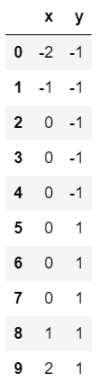

# BEGIN PROB

For the DataFrame `df` shown in full below, both the `"x"` and
`"y"` columns have a mean of 0 and a standard deviation of 1. Calculate
the correlation between `"x"` and `"y"`.

# BEGIN SOLUTION

**Answer**: 0.6

The correlation coefficient is the **mean of the products** of x and y, both in **standard units**:

$$r = \text{mean}\big( x_{\text{su}} \cdot y_{\text{su}} \big), \qquad x_{\text{su}} = \frac{x - \text{mean}(x)}{\text{SD}(x)}$$

The quiz says both columns have **mean 0 and SD 1**, so the data is **already in standard units**. Converting gives back the same numbers, since (x − 0)/1 = x. So we just multiply each row's x and y and take the average:

| row | x | y | x · y |
|---|---|---|---|
| 0 | −2 | −1 | 2 |
| 1 | −1 | −1 | 1 |
| 2 | 0 | −1 | 0 |
| 3 | 0 | −1 | 0 |
| 4 | 0 | −1 | 0 |
| 5 | 0 | 1 | 0 |
| 6 | 0 | 1 | 0 |
| 7 | 0 | 1 | 0 |
| 8 | 1 | 1 | 1 |
| 9 | 2 | 1 | 2 |
| **Sum** | | | **6** |

$$r = \frac{6}{10} = 0.6$$

<average>48</average>

# END SOLUTION

# END PROB